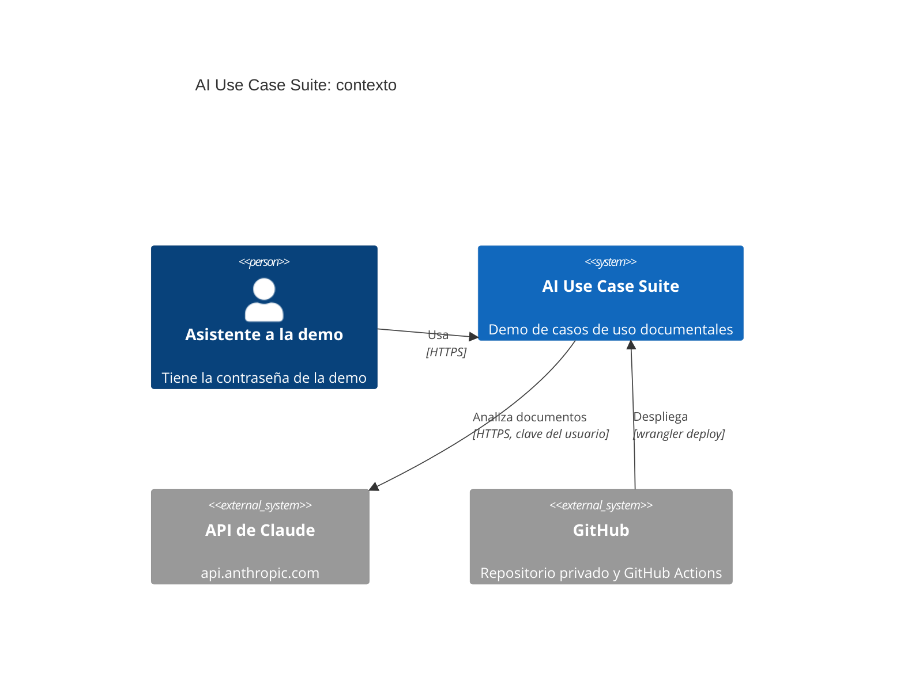
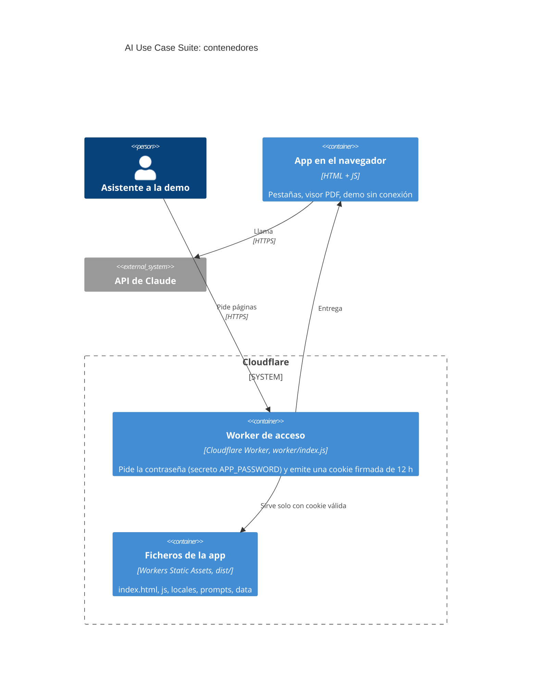

# Arquitectura

La demo es una página estática que llama a la API de Claude desde el navegador con la clave que pega el usuario.
Se publica con un Worker de Cloudflare que exige contraseña antes de servir cualquier fichero.

## Contexto (C4 nivel 1)

## Contenedores (C4 nivel 2)

## Despliegue

- `make build` copia a `dist/` una lista blanca de ficheros (`scripts/build.sh`). Nunca se publican `key`, `Demo docs/` ni el material interno.
- `make deploy` publica el Worker; `make secret` guarda o cambia la contraseña como secreto del Worker.
- GitHub Actions (`.github/workflows/deploy.yml`) despliega en cada push a `main` cuando la variable `CLOUDFLARE_DEPLOY` vale `true` y existen los secretos `CLOUDFLARE_API_TOKEN` y `CLOUDFLARE_ACCOUNT_ID`.
- No hay Terraform: el único recurso es el Worker, declarado en `wrangler.jsonc`.
